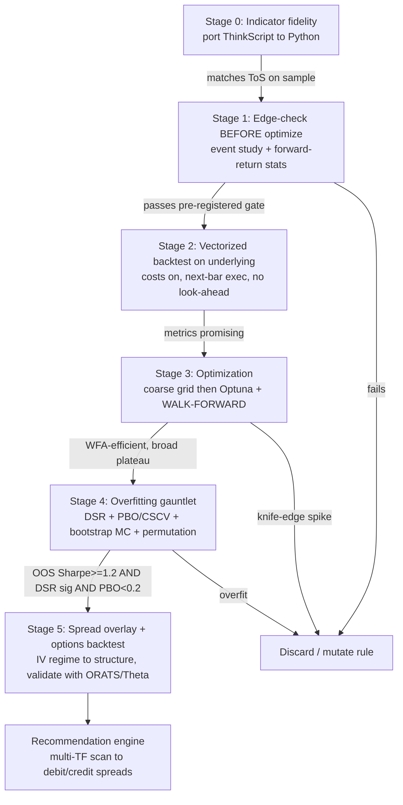
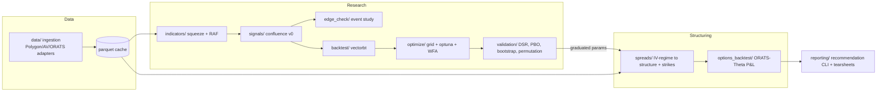

# Confluence Squeeze + RAF → Options-Spread Recommendation Engine
### Build Spec & Claude Code Playbook (v1)

---

## 0. Verdict first (what we're building and why this shape)

You are building a **two-layer system**:

1. **Signal layer (where your Sharpe ≥ 1.2 target lives).** A directional edge on the *underlying* (SPX-500 names + high-vol ETFs), generated by the confluence of your two indicators, computed on **2h / 4h / 1d** bars. This is validated with a rigorous, gated pipeline: fidelity → edge-check → backtest → walk-forward optimization → overfitting gauntlet.

2. **Structuring layer (the recommendation).** A rules-based overlay that converts a graduated signal into a **debit or credit vertical spread**, picking *structure* from the **IV regime**, *strikes* from **delta + expected move**, and *expiration (DTE)* from the **holding-horizon bucket** (1 / 2 / 3 / 5 days). Validated separately with historical options data.

**The single biggest mistake to avoid:** treating "underlying signal Sharpe" and "spread Sharpe" as the same number. They are not. Prove the signal first; the spread is a second, separately-validated phase.

---

## 1. Decision register (reframes — accept or override before Claude Code starts)

| # | Decision | Default I'm proposing | Why |
|---|----------|----------------------|-----|
| **D1** | Sharpe target applies to… | The **underlying signal strategy**, OOS, trailing 2y | Options-spread Sharpe needs IV data; gate the cheap layer first |
| **D2** | Meaning of the 6 "timeframes" | **2h/4h/1d = signal bars**; **1/2/3/5d = holding-horizon → DTE buckets** | 2d/3d/5d bars are data-poor and degenerate; horizons are what recs need |
| **D3** | Direction | **Long *and* short.** Generalize the squeeze "ideal" (long-only) into a symmetric bull/bear rule using its components | Spreads need both sides (bull = call debit / put credit; bear = put debit / call credit) |
| **D4** | Debit vs credit driver | **IV regime (IV-rank/percentile + term structure)**, not price signal | The price signal gives *direction*; vol regime gives *structure* |
| **D5** | Overfit defense | Walk-forward + **Deflated Sharpe Ratio** + **PBO via CSCV** + bootstrap MC + permutation test | Your "MC on top 10–20, least overfit" instinct, made statistically rigorous |
| **D6** | Universe realism | **Point-in-time SPX-500 constituents** (or accept survivorship bias with a logged caveat) + curated high-vol ETF list | Today's index members ≠ 2-years-ago members; survivorship inflates results |

If you disagree with any of these, change them here and the rest of the spec re-flows.

---

## 2. Part A — What your two indicators actually do (decoded into exact rules)

Claude Code must port these to Python **bit-for-bit** and prove fidelity against ThinkOrSwim before anything else. Below is the decode; the code-level traps are in §7.

### 2.1 `squeezeultra.ts` — TTM Squeeze Pro variant (compression + trend + momentum)

Constants: `nBB = 2.0`; `Length = 13` for intraday (2h/4h), `21` for daily+; Keltner ATR multipliers `High=1.0, Mid=1.5, Low=2.0` (ATR via **EMA of TrueRange**).

**Squeeze tightness state** (the dots):
```
BB_upper      = EMA(close, L) + 2.0 * stdev(close, L)
shift         = EMA(TrueRange, L)                      # EMA-smoothed ATR
KC_upper(m)   = SMA(close, L) + shift * m              # NOTE: SMA basis (not EMA) — keep as-is
state = 3 if BB_upper <= KC_upper(1.0)   # tightest  → strongest compression
        2 elif BB_upper <= KC_upper(1.5) # mid
        1 elif BB_upper <= KC_upper(2.0) # loose
        0 otherwise                      # no squeeze
```
A **"fire"** = state transitions from ≥1 to 0 (compression releases → volatility expansion begins). This is the tradeable event.

**Momentum histogram** = standard TTM Squeeze momentum (linear-regression of `close − ½·((Donchian-mid(L)) + SMA(close,L))` over `L`). Color/state logic:
```
rising  & ≥0 → "Up"            (bullish, accelerating)   ← strongest long
rising  & <0 → "DownDecreasing"(bearish, fading)         ← early reversal up
falling & ≥0 → "UpDecreasing"  (bullish, fading)
falling & <0 → "Down"          (bearish, accelerating)   ← strongest short
```

**EMA ribbon trend:** `EMA8, EMA13, EMA21`; `bullish = EMA8>EMA13>EMA21`; `slopingUp = EMA13↑ and EMA21↑`.

**Packaged "ideal squeeze" (long-only):** `bullish AND slopingUp AND state==2`. We generalize this (D3) to a symmetric bear version.

> **Role of this indicator:** *When* the move fires + *which way* the fast trend leans + a built-in **volatility-compression read** (feeds D4).

### 2.2 `RAF.ts` — Ready-Aim-Fire / Relative Adaptive Filter (momentum inflection + regime)

Three EMA stochastics normalized to [−1, 1]: `k1v` (5,3 = fast), `k2v` (8,5 = medium), `k3v` (17,5 = slow).

**Trend regime (displaced TEMA):**
```
tavg      = TEMA(close, 28)
savg      = tavg shifted 14 bars into the PAST   # GetValue(tavg, 14) == tavg[14] — see trap T1
matr      = 0.5 * ATR(10)
savgstate = +1 if low  > savg + matr   # strong uptrend
            -1 if high < savg - matr   # strong downtrend
             0 otherwise
ADX(14) rising = trend-strength confirmation
```

**Setup Count `SC` (the Ready/Aim staging):** regime-flips on the sign of `k2v`.
```
if k2v > 0:  SC = min(0, SC[-1]) + (-1 if k1 crosses BELOW k2 while k2[-1]>0 else 0)   # builds SELL (negative)
else:        SC = max(0, SC[-1]) + (+1 if k1 crosses ABOVE k2 while k2[-1]<=0 else 0)  # builds BUY (positive)
```
Interpretation: `SC==+1`→**Ready Buy**, `SC>+1`→**Aim Buy**, `SC==−1`→**Ready Sell**, `SC<−1`→**Aim Sell**. Magnitude = count of confirming crosses.

**Fisher of slow stoch = the "Fire" line (`Major`):**
```
f3 = 0.5 * ( ln((1+k3v)/(1-k3v)) + f3[-1] )          # Fisher transform, recursively smoothed
MajorBuy  arrow when curvature turns up   (sign(Δf3) > sign(Δf3[-1]))
MajorSell arrow when curvature turns down
OB/OS threshold = 1.2
```

**Full FIRE signal (from the alert logic):**
```
BUY  = (SC > 1  i.e. Aim)  AND  MajorBuy  <= -1.2   # Fisher inflecting up from oversold
SELL = (SC < -1 i.e. Aim)  AND  MajorSell >= +1.2   # Fisher inflecting down from overbought
```

> **Role of this indicator:** multi-stage **confirmation + momentum-inflection timing**, with an independent **trend regime** (displaced TEMA) and **trend-strength** (ADX) context. It is mean-reversion-flavored: it fires as exhausted momentum inflects.

### 2.3 Why they pair well

- **Squeeze = breakout/expansion engine** ("the move is loaded and about to fire, fast-trend leans this way").
- **RAF = inflection/confirmation engine** ("momentum is turning and the regime supports it").

Squeeze answers *when + energy*; RAF answers *is it really turning + does the bigger trend agree*. Trading their **confluence** filters the large class of squeeze-fires that fizzle and RAF-inflections that fade.

---

## 3. Part B — The strategy hypothesis ("internal rule" to validate)

This is the **Confluence v0** rule Claude Code validates *before* any optimization (your "validate the interrule first" instruction). It is deliberately explicit — entries **and** exits, because exits drive Sharpe as much as entries.

### 3.1 Confluence v0 — LONG (mirror for SHORT)

**Regime gate (must hold):**
- Squeeze EMA ribbon `bullish` (EMA8>EMA13>EMA21), AND
- RAF `savgstate >= 0` (price not pinned below displaced-TEMA−band). *(Optional add-on to test: ADX rising.)*

**Energy gate:** squeeze `state >= 1` at some point in the last `N` bars (compression loaded; `N` is a parameter, e.g. 6).

**Trigger (evaluate at bar close → execute next bar open):** test these three confluence modes head-to-head and let the data pick:
- **Mode A (AND):** squeeze fires (`state→0`) with histogram `Up`/rising **AND** RAF `SC >= 1` (≥ Ready Buy).
- **Mode B (RAF-led):** RAF full **Fire Buy** (`SC>1` & `MajorBuy<=-1.2`) **AND** squeeze histogram non-bearish (`Up`/`UpDecreasing`).
- **Mode C (weighted score):** combine normalized sub-signals into a 0–1 score, enter above a threshold. (Keeps you from a brittle boolean.)

**Exits (specify all; test which combination wins):**
- **Time stop:** `H` bars, where `H` is tied to the signal timeframe's holding-horizon (see §4) — this is what makes the exit DTE-compatible.
- **Momentum exit:** histogram flips to opposite color, OR RAF prints opposite Fire.
- **Hard stop:** `k_stop · ATR(14)` below entry (structure-aware).
- **Profit target:** `R`-multiple of risk, OR ATR-based expected move for the horizon.

**Position sizing:** vol-target (e.g., size so each trade risks a fixed % at the ATR stop) — *not* fixed share count. This stabilizes Sharpe across the 500-name universe and the high-vol ETFs.

### 3.2 What "validate before backtest" means operationally

It means: **do not optimize a rule that has no raw edge.** Stage 1 (§5) runs an event study on Confluence v0 with *default* parameters and a pre-registered pass/fail gate. Only rules that clear the gate proceed to optimization. This is the discipline your prompt is asking for, formalized.

---

## 4. Part C — Timeframe → expiration (DTE) mapping + multi-TF scan

Signals are generated on **2h, 4h, 1d** bars. Each signal is tagged with a **holding-horizon bucket**, which sets the **target DTE band** for the recommended spread. This is how your "1/2/3/5 day timeframes" become actionable.

| Signal bar | Typical hold | Holding bucket | Target DTE band | Notes |
|-----------|--------------|----------------|-----------------|-------|
| 2h | intraday → 1 day | **1-day** | **0–2 DTE** | nearest weekly / 0DTE; theta-fast, tightest strikes |
| 2h–4h | ~1 day | **2-day** | **2–5 DTE** | |
| 4h–1d | 1–3 days | **3-day** | **5–10 DTE** | |
| 1d (swing) | 3–5 days | **5-day** | **7–21 DTE** | widest strikes; most IV-sensitive |

**Multi-timeframe scan logic (recommendation engine):**
- Run the signal layer independently per timeframe per symbol.
- **Alignment bonus:** when 4h and 1d agree on direction, raise conviction (and prefer the longer-horizon spread). When they conflict, down-rank or skip.
- Each recommendation row carries: symbol, signal TF, direction, holding bucket, conviction score, IV regime, and the resulting spread (structure/strikes/DTE/credit-debit/POP/expectancy).

---

## 5. Part E — Validation pipeline (the gated funnel)



### Stage 0 — Indicator fidelity (gate: numeric + visual match)
Export ToS series for 2–3 symbols across 2h/4h/1d. The Python port of squeeze state, histogram, EMA ribbon, RAF `SC`, `Major`, `savgstate` must match within tolerance. **No fidelity → no trust in any backtest.**

### Stage 1 — Edge-check **before** optimization (gate: pre-registered)
Event study on Confluence v0 (default params):
- Align all entry signals; measure forward returns at +1…+H bars (and +1…+5 days).
- Report: mean & median forward return, **hit rate**, **t-stat**, return distribution, and the same for a **random-entry baseline** at matched frequency.
- **Pre-registered pass gate (lock before running):** e.g. hit rate ≥ 53%, mean forward return exceeds round-trip cost by a defined margin, t-stat ≥ 2, and a roughly monotonic relationship between conviction score and forward return.
- **Fail → discard or mutate. Do not optimize.**

### Stage 2 — Vectorized backtest on the underlying (engine: `vectorbt`)
- **Costs always on:** commission + slippage (stocks ~1–3 bps + half-spread; conservative). Leveraged ETFs: wider slippage.
- **Execution at next-bar open**; signal computed on prior close. No same-bar peeking.
- Cross-sectional (same params across the universe), vol-targeted sizing.
- Output the full table: CAGR, **Sharpe**, Sortino, MaxDD, Calmar, exposure, trades, win rate, profit factor, avg win/loss, turnover.

### Stage 3 — Optimization (only if Stage 2 is promising)
- **Params:** squeeze `L`/KC mults/`N`, EMA ribbon lengths, RAF `ProLength`/OB-OS/`SC` requirement, confluence **mode** (A/B/C) + threshold, exit set (`H`, `k_stop`, `R`).
- **Method:** coarse grid → **Optuna** (Bayesian) refine.
- **Walk-forward analysis** (anchored or rolling): optimize on IS window, validate on adjacent OOS, roll forward. Report **WFA efficiency** = OOS/IS performance ratio.
- **Anti-overfit hygiene:** prefer broad performance *plateaus* over sharp spikes; cap free-parameter count; keep **≥ ~30 trades per free parameter**.

### Stage 4 — Overfitting gauntlet on the top 10–20 (your MC step, rigorous)
Run all of these; a strategy must survive the whole battery:
- **(a) Deflated Sharpe Ratio (DSR)** — deflate the best Sharpe by the **number of trials** you tested + correct for skew/kurtosis (Bailey & López de Prado). Require Sharpe significantly > target *after* the N-trials penalty.
- **(b) PBO via CSCV** (`pypbo`) — probability the IS-best config underperforms the OOS median. **Require PBO < ~0.2.**
- **(c) Bootstrap MC** — block/stationary bootstrap of the trade/return stream → distribution of Sharpe, CAGR, MaxDD. **Require 5th-percentile Sharpe respectable and median ≥ 1.2.**
- **(d) Monte Carlo permutation test** — shuffle signal↔return alignment / randomize entries at matched frequency → real Sharpe must sit in the right tail (e.g., > 95th pct of the null).
- **(e) Parameter-neighborhood robustness** — perturb optimal params ±1 step; performance must degrade *gracefully*, not cliff-edge.
- **(f) Regime/subperiod stability** — split by year and by vol regime (bull/bear/chop); edge must persist, not live in one window.

**Graduation gate (all must hold):** OOS Sharpe ≥ 1.2 trailing 2y **AND** DSR significant **AND** PBO < 0.2 **AND** bootstrap 5th-pct acceptable **AND** survives permutation + neighborhood + subperiod.

### Stage 5 — Spread overlay + options validation (Phase 2 / paid data)
- Map graduated signals → spread structure via §6.
- **Reconstruct option P&L** at entry/exit from historical options data (ORATS / ThetaData): per-leg price, net debit/credit, **POP**, expectancy, max-profit/max-loss, and the **realized spread Sharpe** (the number that actually matters for the recs).
- Compare spread Sharpe to the underlying-signal Sharpe — expect them to differ; that delta is the cost/benefit of the structure.

---

## 6. Part D — Debit vs Credit decision matrix + strike/DTE selection

**Direction** comes from the signal (§3). **Structure** comes from the **IV regime** (D4). Compute **IV-rank** and **IV-percentile** (e.g., 252-day lookback) + a simple **term-structure** read.

| Direction | Low IV-rank (< ~30) | High IV-rank (> ~50) |
|-----------|---------------------|----------------------|
| **Bullish** | **Bull call DEBIT spread** (buy premium; squeeze-compression + low IV = ideal expansion play) | **Bull put CREDIT spread** (sell premium; +theta) |
| **Bearish** | **Bear put DEBIT spread** | **Bear call CREDIT spread** |

> The synergy: a **tight squeeze frequently coincides with depressed IV** → the most attractive *debit* setups are exactly "loaded squeeze + low IV-rank + directional confluence," where you buy cheap premium right before the expansion the squeeze is predicting.

**Strike selection (per structure):**
- **Debit:** long leg ≈ **0.45–0.55 delta** (near ATM), short leg ≈ **0.25–0.30 delta**. Width ≈ a fraction of the horizon's expected move.
- **Credit:** short leg ≈ **0.25–0.35 delta**, long leg one strike wider. Target credit ≈ ⅓–½ of width.
- **Expected move for the horizon:** `EM ≈ price · IV · sqrt(DTE/365)`, cross-checked against `ATR(14) · sqrt(horizon_bars)`. Strikes should respect EM, not fight it.

**DTE:** from the holding bucket (§4 table).

**Always report per rec:** structure, both strikes + deltas, net debit/credit, max profit, max loss, breakeven(s), **POP**, expectancy, and IV-rank context.

---

## 7. Code-level traps Claude Code must get right (high-value, easy to botch)

- **T1 — RAF displaced TEMA is a *backward* lag.** `GetValue(tavg, 14)` = `tavg` **14 bars ago** → `savg = tavg.shift(14)`. **Never** `shift(-14)` (forward/centered) — that injects look-ahead and will fabricate a beautiful, fake edge.
- **T2 — Squeeze basis asymmetry is intentional.** BB uses an **EMA** basis; Keltner uses an **SMA** basis with **EMA-of-TrueRange** for width. Replicate exactly; don't "tidy" it.
- **T3 — TTM histogram formula must match ToS.** Linear-regression form over `Length`; validate numerically in Stage 0.
- **T4 — `StochasticFull` uses EXPONENTIAL averaging** in RAF; `TEMA`/`ADX` must match ToS conventions.
- **T5 — Next-bar execution, costs always on.** Signal on close[t], fill at open[t+1]. No exceptions, ever, in any code path.
- **T6 — Point-in-time universe** or a logged survivorship caveat (D6).
- **T7 — Leveraged-ETF hygiene:** handle reverse splits; remember UVXY/VXX carry a structural decay (short-vol drift) that biases naive long tests.

---

## 8. Part F — Data plan (grounded, June 2026)

**Underlying (2h/4h/1d, 500 names + ETFs, ≥2y):**
- **Polygon.io** or **Databento** — practical depth/quality for intraday at universe scale.
- **Alpha Vantage** (you have it connected) — usable, but `TIME_SERIES_INTRADAY` extended history comes in rate-limited monthly slices; fine for a pilot subset, painful for 500×2h. Use it for prototyping, not the full pull.
- **Point-in-time constituents:** Norgate (or accept survivorship with a logged caveat).

**Options (Phase 2 — IV + greeks for spread validation):**
- **ORATS** — EOD options analytics back to **2007**; best *backtesting depth* (and you've used it before). Strong default.
- **ThetaData** — raw trades/quotes + **1st/2nd/3rd-order greeks** + IV, EOD or tick; good if you want to compute your own.
- **Polygon options** — raw US options since **2014**.
- **EODHD** — ~2y options history, ~$99/mo, 6,000+ liquid US names; the budget pilot option.

> Treat all vendor prices/tiers as "verify on the provider's site" — options-data pricing changes constantly. Start with the **cheapest tier that has 2y of IV+greeks for your shortlist**, prove the spread layer, then scale the data buy.

**High-vol ETF universe (starter):** TQQQ/SQQQ, SOXL/SOXS, SPXL/SPXS, LABU/LABD, TNA/TZA, UVXY/VXX (decay-aware), plus liquid single-name high-IV growth names. Curate for **options liquidity** (tight spreads, real open interest) — illiquid chains make spread fills fiction.

---

## 9. Part G — System architecture & repo layout



**Repo skeleton:**
```
squeeze-raf-engine/
├── CLAUDE.md                  # the constitution (see §10.1)
├── pyproject.toml             # uv/poetry, pinned deps
├── config/                    # YAML: universe, params, costs, gates
├── data/                      # adapters + parquet cache (NOT in git)
├── indicators/                # squeeze.py, raf.py  (+ fidelity fixtures)
├── signals/                   # confluence.py (modes A/B/C), scoring
├── edge_check/                # event_study.py, gates.py
├── backtest/                  # engine.py (vectorbt), costs.py, sizing.py
├── optimize/                  # grid.py, optuna_search.py, walkforward.py
├── validation/                # dsr.py, pbo_cscv.py, bootstrap.py, permutation.py
├── spreads/                   # iv_regime.py, structure.py, strikes.py, dte.py
├── options_backtest/          # orats_adapter.py, theta_adapter.py, spread_pnl.py
├── reporting/                 # tearsheet.py, recommend.py (multi-TF scan)
├── tests/                     # look-ahead tests, fidelity tests, gate tests
└── decisions.md  risks.md     # living registers
```

**Core deps:** `vectorbt`, `pandas`, `numpy`, `numba`, `scipy`, `optuna`, `pypbo`, `pyarrow`, `pydantic`, `httpx`, `matplotlib`, `pytest`. (Upgrade path: **VectorBT PRO** for faster robustness sweeps; **NautilusTrader** only if/when you go to realistic execution / live.)

---

## 10. Part H — How to instruct Claude Code (the playbook)

The meta-trick: **make Claude Code build gates, not just scripts.** Phrase tasks so the deliverable is "a check that refuses to proceed unless X," and force test-first on the two things AI most easily fakes: **look-ahead** and **indicator fidelity**.

### 10.1 Seed `CLAUDE.md` (paste this as the repo's constitution)

```markdown
# Project: Confluence Squeeze + RAF → Options-Spread Recommendation Engine

## Goal
Prove a directional signal edge on the UNDERLYING (SPX-500 + high-vol ETFs) on 2h/4h/1d
bars, OOS Sharpe >= 1.2 trailing 2y, then overlay a debit/credit vertical-spread
recommender (structure from IV regime, strikes from delta+expected-move, DTE from
holding horizon) validated with historical options data.

## Non-negotiable rules (NEVER violate in any code path)
1. NO LOOK-AHEAD. Signal on close[t], execute at open[t+1]. The RAF displaced TEMA is a
   BACKWARD lag: savg = tavg.shift(14). Never shift(-14).
2. COSTS ALWAYS ON (commission + slippage). No "frictionless" runs in results.
3. A strategy MUST pass the Stage-1 edge-check (event study, pre-registered gate) BEFORE
   any optimization. Never optimize an unvalidated rule.
4. Every optimization MUST use walk-forward; report WFA efficiency.
5. Every graduate MUST pass: Deflated Sharpe (trial-count corrected) + PBO/CSCV < 0.2 +
   bootstrap MC (5th-pct acceptable, median >= 1.2) + permutation test + neighborhood +
   subperiod stability. ALL of them.
6. Indicator ports MUST pass fidelity tests vs ToS fixtures before use.
7. Deterministic seeds everywhere. Log every run's config hash.
8. Point-in-time universe (or log a survivorship caveat).
9. Underlying-signal Sharpe != spread Sharpe. Validate the spread layer separately.

## Anti-overfitting discipline (for YOU, the AI)
- The OOS / holdout window is LOCKED. Do not look at it, tune to it, or report on it until
  the final graduation gate.
- Pre-register all gate thresholds in config/ before running; do not move the goalposts to
  let a strategy pass.
- Prefer broad parameter plateaus over sharp peaks. Flag knife-edge optima as suspect.
- Keep >= ~30 trades per free parameter; refuse to optimize past that budget.

## Workflow
- Work in phases (see plan). One phase per branch; commit at each green gate.
- Test-first for look-ahead and fidelity. Show me the metrics table at every gate and STOP
  for my go/no-go before the next phase.
- Keep decisions.md and risks.md updated as you make choices.
```

### 10.2 Bootstrap prompt (first message to Claude Code)

> "Read `CLAUDE.md`. Scaffold the repo per the skeleton in the spec (I'll paste it). Set up `pyproject.toml` with uv, pinned deps (`vectorbt, pandas, numpy, numba, scipy, optuna, pypbo, pyarrow, pydantic, httpx, matplotlib, pytest`), a `config/` with YAML for universe + costs + gate thresholds, and a `tests/` folder. Create stub modules with docstrings stating each module's contract. **Do not implement logic yet.** Then write `decisions.md` and `risks.md` pre-seeded from the spec's registers. Show me the tree and the configs, then stop."

### 10.3 Phase prompts (run in order; each ends at a gate)

| Phase | Prompt (paste, adapt) | Gate before proceeding |
|-------|------------------------|--------------------------|
| **P1 Data** | "Implement the data layer: Polygon + Alpha Vantage adapters for 2h/4h/1d OHLCV, parquet cache, a small pilot universe (10 names + 5 ETFs). Handle splits. Write a data-integrity test (no gaps/dupes, monotonic timestamps). Show a coverage report." | Clean 2y pilot data cached + integrity test green |
| **P2 Indicators + fidelity** | "Port `squeezeultra` and `RAF` to Python exactly per spec §2 and the traps in §7. I'll provide ToS export fixtures. Write fidelity tests asserting numeric match within tolerance. **Test-first.** Show the diff stats vs ToS." | Fidelity tests green on all 3 fixtures |
| **P3 Edge-check** | "Implement Confluence v0 (§3) with default params and modes A/B/C. Build the Stage-1 event study + the pre-registered gate from config. Run it; show the forward-return table, hit rate, t-stats, vs random baseline, per mode and per timeframe. Recommend pass/fail per the gate — do NOT optimize." | A rule passes the locked edge gate |
| **P4 Backtest** | "Build the vectorbt engine: next-bar exec, costs on, vol-target sizing, long+short. Run Confluence v0 (passing mode) on the pilot universe across 2h/4h/1d. Output the full metrics table + an equity/drawdown tearsheet. Add a look-ahead unit test that fails if any signal uses same-bar close for same-bar fill." | Look-ahead test green; metrics plausible |
| **P5 Optimize + WFA** | "Implement coarse grid → Optuna with walk-forward (anchored). Optimize per spec §5 Stage 3. Enforce the >=30-trades-per-param budget. Output: top-20 configs, WFA efficiency, and a plateau heatmap. Keep the OOS window locked." | WFA-efficient, broad-plateau top configs |
| **P6 Gauntlet** | "On the top 10–20 configs, run the full overfitting battery (§5 Stage 4): Deflated Sharpe (trial-count corrected), PBO via CSCV (pypbo), block-bootstrap MC, permutation test, neighborhood robustness, subperiod stability. Produce one ranked table with every metric + a PASS/FAIL against the graduation gate." | ≥1 config clears the full gate |
| **P7 Spread engine** | "Implement IV-regime (IV-rank/percentile + term structure), the debit/credit matrix (§6), delta+expected-move strike selection, and DTE-from-horizon. Output spread recs (structure/strikes/deltas/credit-debit/POP/expectancy) for current signals on the pilot universe." | Recs sane vs hand-checks |
| **P8 Options backtest** | "Add ORATS (or ThetaData) adapter; reconstruct entry/exit option P&L for graduated signals; compute realized spread Sharpe, POP, expectancy. Compare spread Sharpe vs underlying-signal Sharpe and explain the delta." | Spread layer validated on real IV data |
| **P9 Recommender CLI** | "Build `reporting/recommend.py`: multi-TF scan over the full universe, alignment bonus when 4h+1d agree, ranked recommendation output (CSV + tearsheet) tagged by timeframe and holding bucket. Add `--paper` mode wiring to a Tradier sandbox for forward testing." | End-to-end recs reproduce on a fixed date |

### 10.4 Guardrails that keep the AI honest

- **Force test-first** on look-ahead (T5) and fidelity (T1–T4). These are where a hurried agent silently cheats and manufactures Sharpe.
- **Gate, don't sprint.** End every phase with "show me the table and STOP." Don't let it chain phases unsupervised.
- **Lock the OOS window in config** and tell it explicitly not to read it until P6. Re-state this; agents drift.
- **Pre-register thresholds** in `config/gates.yaml` before P5 so the AI can't move goalposts to pass.
- **Golden fixtures:** keep ToS exports + a tiny synthetic dataset with known signals as regression tests.
- **Decision/risk registers live:** require updates to `decisions.md`/`risks.md` each phase (your established habit — it also gives you an audit trail of every assumption the AI made).
- Use **plan mode / sub-agents** for P5–P6 (the heavy, error-prone steps).

---

## 11. Part I — Risk register (top failure modes)

| Risk | Impact | Mitigation |
|------|--------|-----------|
| Look-ahead via RAF displaced TEMA (T1) | Fake edge, total | Backward-shift only; explicit unit test |
| Survivorship bias in SPX-500 | Inflated Sharpe | Point-in-time constituents (D6) |
| Selection bias from testing many configs | Sharpe looks > it is | **Deflated Sharpe** + **PBO** are mandatory, not optional |
| Confusing underlying vs spread Sharpe | Recs underperform backtest | Validate spread layer on real IV data (P8) |
| Illiquid option chains | Backtest fills are fiction | Curate universe by option liquidity (OI + spread) |
| Knife-edge optimum | Live degradation | Neighborhood test + plateau preference |
| Intraday data gaps/limits (Alpha Vantage) | Silent holes | Integrity test (P1); Polygon/Databento for scale |
| Agent goal-hacks the gate | Believable but overfit | Lock OOS, pre-register thresholds, test-first |
| Leveraged-ETF decay/splits (T7) | Skewed long tests | Split-adjust; decay-aware on UVXY/VXX |

---

## 12. Appendix — Gate thresholds (starting values; put in `config/gates.yaml`)

| Gate | Metric | Starting threshold |
|------|--------|--------------------|
| Stage 1 edge | hit rate | ≥ 53% |
| Stage 1 edge | forward-return t-stat | ≥ 2.0 |
| Stage 1 edge | mean fwd return vs cost | exceeds round-trip by defined margin |
| Stage 4 | OOS Sharpe (2y) | ≥ 1.2 |
| Stage 4 | PBO (CSCV) | < 0.20 |
| Stage 4 | Deflated Sharpe | significant after N-trials correction |
| Stage 4 | Bootstrap Sharpe (5th pct) | > 0 (ideally ≥ 0.5); median ≥ 1.2 |
| Stage 4 | Permutation test | real Sharpe > 95th pct of null |
| Optimization | trades per free param | ≥ ~30 |

---

### TL;DR sequence
**Decode indicators → port + prove fidelity → edge-check Confluence v0 *before* optimizing → walk-forward optimize → survive the DSR/PBO/bootstrap/permutation gauntlet → only then overlay debit/credit spreads and validate that layer on real options data → ship the multi-timeframe recommender.** Gate every step; lock the holdout; never confuse the underlying's Sharpe with the spread's.
